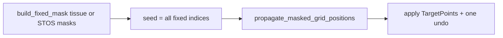

# Relax exterior grid points

## Why the lattice stays rigid

Masked-neighbor relax already exists ([`grid_layout_relax.py`](nornir-imageregistration/nornir_imageregistration/grid_layout_relax.py), [`masked_grid_relax.py`](nornir-pyre/pyre/controllers/masked_grid_relax.py)): free points (cell unmasked fraction below `masked_relax_min_unmasked`, including black / off-image via the tissue fallback in `resolve_stos_masks`) only move when a **seed** starts a BFS wave. Spacebar/drag seed that for neighbors of a move; a bulk warped interior can leave a large exterior free region never visited, so those points keep the original rectangular Target lattice.

## Approach

Reuse the existing visit-once local-similarity BFS (same energy model as Spacebar-on-masked). Do **not** add a second solver.

1. **Controller API** in [`transformcontroller.py`](nornir-pyre/pyre/controllers/transformcontroller.py): add `enqueue_relax_exterior_grid_points()` (name can match menu wording) that:
   - no-ops unless `masked_grid_relax.grid_model_or_none(self)` is a grid;
   - builds `fixed_mask` the same way `_start_masked_grid_relax_wave` does (`resolve_stos_masks`, `get_or_build_source_ok`, `build_fixed_mask`);
   - seeds with **every fixed index** (`np.flatnonzero(fixed_mask)`), so free exterior components attached to the pinned interior are reached;
   - calls existing `enqueue_masked_grid_relax(seeds, undo_points=self.copy_points())`;
   - no-ops when there are no free points or no fixed seeds.

2. **Menu** in [`stoswindow.py`](nornir-pyre/pyre/ui/windows/stoswindow.py) Registration menu, next to **Remove Points on Masked Areas**:
   - **Relax Exterior Grid Points**
   - enabled only for grid transforms (same pattern as `_update_refinement_menu_state`);
   - Escape / Cancel Registration already cancels in-flight masked relax via generation bump — keep that.

3. **Tests** in [`test_masked_grid_relax.py`](nornir-pyre/tests/test_masked_grid_relax.py) (and a small layout unit if useful):
   - Fixed interior + free exterior ring: after bulk relax, exterior TargetPoints move toward local-similarity with the warped fixed boundary; fixed points unchanged.
   - All-fixed / non-grid: no-op.
   - Assert `LoadChecksum`-style unrelated paths untouched; prove free points change without requiring a prior Spacebar seed.

4. **User-facing note** in [`CHANGELOG.user.md`](nornir-pyre/pyre/CHANGELOG.user.md): one line that Registration can settle exterior/masked grid points with the same spring relax used after Spacebar.

## Defaults chosen

- Manual menu only (not auto after every registration).
- Free vs fixed = existing mask/tissue classification (`masked_relax_min_unmasked`), not a new bbox-only rule — matches the black-canvas exterior in the screenshot.
- One BFS wave (existing), not iterative `RelaxLayout` until tension zero.
